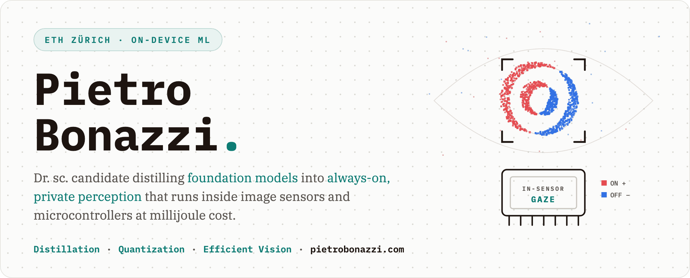

<a href="https://pietrobonazzi.com">
  <picture>
    <source media="(prefers-color-scheme: dark)" srcset="./assets/hero-dark.gif" />
    <source media="(prefers-color-scheme: light)" srcset="./assets/hero-light.gif" />
    
  </picture>
</a>

<a href="https://pietrobonazzi.com">
  <picture>
    <source media="(prefers-color-scheme: dark)" srcset="./assets/bento-dark.png" />
    <source media="(prefers-color-scheme: light)" srcset="./assets/bento-light.png" />
    
  </picture>
</a>

### Selected work

| Project | Venue | What it does |
|---|---|---|
| [**PicoSAM3**](https://github.com/pbonazzi/picosam3) | IEEE Sensors Journal 2026 | Promptable segmentation distilled from SAM3 — 1.3 MB INT8, 65.3% COCO mIoU, 11.8 ms inside the image sensor |
| [**FTerViT**](https://arxiv.org/abs/2605.21171) | NeurIPS 2026 | Fully ternary Vision Transformer — 77.5% ImageNet top-1 at 5.8 MB (15× smaller), runs on a $10 MCU |
| [**TinyML Hits the Memory Wall**](https://arxiv.org/abs/2611.03392) | arXiv 2026 | Benchmark of ten sub-watt accelerators: latency follows bytes moved, not MACs |
| [**TinyGLASS**](https://arxiv.org/abs/2603.16451) | AICAS 2026 | Self-supervised anomaly detection in-sensor — 8.6× smaller than GLASS, 20 FPS |
| [**Retina**](https://github.com/pbonazzi/retina) | CVPR Workshops 2024 | Event-camera eye tracking with 63k parameters at 2.89 mW |

[pietrobonazzi.com](https://pietrobonazzi.com) · [@pebonazzi](https://x.com/pebonazzi)
