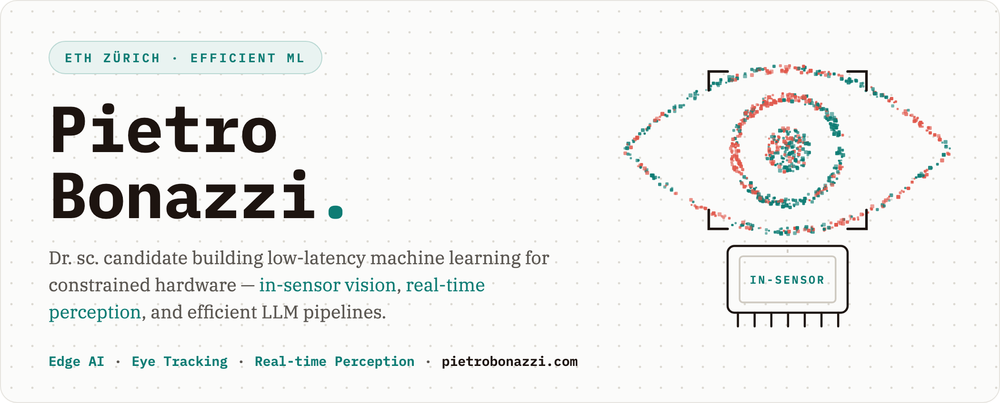
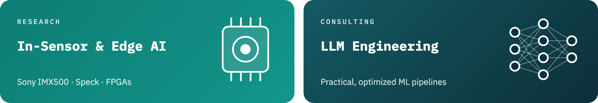

<a href="https://pietrobonazzi.com">
  <picture>
    <source media="(prefers-color-scheme: dark)" srcset="./assets/hero-dark.png" />
    <source media="(prefers-color-scheme: light)" srcset="./assets/hero-light.png" />
    
  </picture>
</a>

<a href="https://pietrobonazzi.com">
  <picture>
    <source media="(prefers-color-scheme: dark)" srcset="./assets/bento-dark.png" />
    <source media="(prefers-color-scheme: light)" srcset="./assets/bento-light.png" />
    
  </picture>
</a>

### Selected work

| Project | Venue | What it does |
|---|---|---|
| [**PicoSAM3**](https://github.com/pbonazzi/picosam3) | SENSORS 2025 | Segmentation models running in-sensor on the Sony IMX500 |
| [**Eva**](https://github.com/pbonazzi/eva) | CVPR 2025 | Event-based obstacle avoidance on the AMD Xilinx DPU FPGA |
| [**Retina**](https://github.com/pbonazzi/retina) | CVPR 2024 | Eye tracking on the SynSense Speck chip |
| [**TinyTracker**](https://github.com/pbonazzi/tinytracker) | SENSORS 2023 | Fully quantized 2D gaze estimation on IMX500, Coral Dev Micro & Spresense |

[pietrobonazzi.com](https://pietrobonazzi.com) · [@pebonazzi](https://x.com/pebonazzi)
